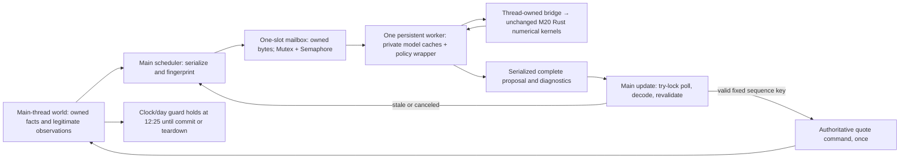

# M21 — Deterministic Rust-backed planning jobs

Implements [issue #27](https://github.com/anoy-maker/simulated-town-rpg/issues/27)
from M20 `2ba5ea7f36ddef96225e1bcabad71d3f05e5b9e7`. Default synchronous
GDScript/native CLI behavior and economic parameters remain unchanged.

**Result:** Complete proposal computation safely runs off-main on the tested
Godot/Rust path. D30 main-update p99 improves **76.166 →16.743 ms**, but the world
still waits at 12:25: median decision appointment **66.742 →84.020 ms**, and
frame-pump elapsed time increases **13.5%**. No instant-movement or earlier
preparation benefit is established. All **3103 Godot checks, 73 Python tests,
169 historical pins and 12 independent full audits pass**. GDScript remains the
default; this is an optional one-owner experiment, not a permanent migration.

## Predeclared experiment

One persistent worker, at most one active request/result; owner Cora, stages C/D.
Serialize permitted observations/beliefs/history before handoff (Godot Variant
bytes preserve f64 and integer types). Worker-owned caches/bridge, no world,
SceneTree or server access, no shared mutable static cache. Complete policy
orchestration plus M20 Rust arithmetic runs on the worker. Main thread alone
validates the snapshot, timestamp, owner, IDs/versions and commits the quote.

A ~60-Hz headless process callback advances one existing appointment or polls
once. At the 12:25 barrier no later authoritative time/action can advance while
planning is pending. Frame heartbeats continue. This does not demonstrate
instant player movement. Reporting/audit/export and explicit shutdown are timed
separately from simulation callbacks. No busy-wait or ordinary-callback join.

Compare synchronous Rust and scheduled Rust in the same frame-pump C/D ×1/3/30
seed42, three fresh processes/case (D30: five, for 150 decision samples),
rotating mode order. Capture direct M20 Rust
30-day controls for context. Warm one one-day process per mode/stage before
measurement; no concurrent verification during timings. Predeclared 500-ms
worker-delay, stale-snapshot, cancellation and shutdown fixtures, n=3 where
measurements are meaningful. Use minimum/median/ranges/worst, p95 for >=20 and
p99 for >=100 samples. Measure callback work, heartbeat spacing, worker compute,
queue/poll/commit delay, appointment barrier and complete run/command separately.

Same full proposals and exact economic/canonical hashes required; projected
values at most M20 absolute 1e-9 if unavoidable, exact choices/events. No changes
to model/horizon/economic behavior after results. Investigate earlier legal
information; implement at most one preparation optimization only if simple and
causally justified. No pre-12:25 calls pretending to have the deposit observation.
Full Godot/Python suites, 169 pins and independent audits after focused checks.

## Ownership, thread safety and authoritative ordering



The job envelope fixes schema version1, monotone job ID, owner `cora`, simulated
day/deadline minute745, stageC/D, exact observation/belief hashes, full input hash
and M18 parameters (14-day horizon, .99 discount, 1e-9 ties, Rust backend).
`var_to_bytes`/`bytes_to_var` preserve actual integer/f64 types, unlike rounded JSON.
Only the original eight observation fields, thirteen-bin cohort data and known
posted prices enter the worker. Shape/bounds/finite/probability checks reject
unknown/private fields, malformed jobs, wrong owner, changed seals/parameters and
nonplanning stages. Requests are at most 64 KiB; results are newly owned bytes.
These hashes are validity fingerprints, not a hostile-client security protocol.

Worker states are **idle → queued → running → completed** (or canceled), then
acknowledged before another request. Main records terminal **committed/stale/
canceled** outcomes. The queue has one request/result slot and strictly increasing
IDs. Commit key is **(day,745,cora,ID)**, independent of wall completion time.
Main checks current time, barrier token, complete permitted inputs, owner/ID,
quote versions and own presence/cargo before invoking the original quote command.
The authoritative command can reject a valid proposal; committing a job does not
mean its requested quote was accepted. No provisional quote/rollback is used.

`planning_jobs_world.gd` is an isolated subclass with a clock/day guard; it cannot
be bypassed by calling ordinary time advancement while a plan is pending. Tokens
and timing remain outside canonical economic snapshots/records. A stale/canceled
result keeps the same barrier, is discarded, then resubmits newly permitted
information at that exact timestamp. At most two retries; if the original
boundary cannot be retained, the run errors rather than rewinding/advancing time.

The **complete** candidate graph, observable outcomes/quadrature, hypothetical
posterior updates, packing, Rust forecasts/continuations, unadapted/adaptive price
searches and proposal serialization run off-main. World observation, snapshot
serialization/fingerprints, actual observed-memory/belief updates, receipt logging,
validation and quote execution remain main-thread work. Worker thread ID differs
from main in every recorded completed job; thread safety checks remain enabled.

The native RefCounted bridge is constructed/registered on main before starting
its worker, then used exclusively there; its computation allocates only local
Variant/packed buffers and calls pure Rust. No scene, server, renderer, resource
loading or live world is accessed off-thread. Optional cache parameters in the
existing pure belief functions select worker-owned dictionaries, suppress shared
profiling writes, and preserve the original default static-cache behavior.
Private traffic components clear between jobs; fixed response rows are bounded
by the model. Unit checks compare the complete proposal exactly and verify that
historical caches/global profiler state remain untouched even with profiling on.

A worker sleeps on a semaphore when idle. Main callbacks poll **once**, using
`Mutex.try_lock`, never spin or join. Cancellation suppresses publication but
cannot interrupt an already-running policy loop; shutdown joins only in explicit
teardown. Repeated lifecycle fixtures measured active teardown **84.271–86.958 ms**
with a controlled 100-ms worker sleep, not a promise of immediate cancellation.
Final tests additionally verify aborted runners cannot resume or apply a result.

References consulted and applied:

- [Godot 4.6 thread-safe APIs](https://docs.godotengine.org/en/4.6/tutorials/performance/thread_safe_apis.html): no active scene-tree access; private containers and synchronized mailbox resizing; no concurrent resource mutation.
- [Godot 4.6 multiple threads](https://docs.godotengine.org/en/4.6/tutorials/performance/using_multiple_threads.html): mutex/semaphore ownership and joining threads at teardown.

No ThreadSanitizer proof, all-platform export or hard real-time guarantee is
claimed. This validates the reviewed Godot 4.6.3 wrapper/bridge path and repeated
runs, not arbitrary scene/server APIs on workers.

## Same-host results: better host service, slower authoritative completion

All performance measurements ran without verification jobs concurrently. Engine,
Rust library, fixed parameters and seed match across modes. Frame-pump control
and scheduled modes both use ~60-Hz `SceneTree._process`; one existing appointment
or one pending-job poll per update. These are synthetic host updates, not measured
graphical FPS or keyboard latency. The existing M18 appointments are a regression
workload, not a new behavioral/sleep schedule imposed to hide computation.

Sixty-four frame-pump runs completed: forty unchanged baseline C/D runs, three
500-ms-delay runs and twenty-one stale/cancel runs. D30 has five repeats/mode;
other cases have three. Six direct, non-frame-pumped Rust controls and three
lifecycle measurements completed separately. Fresh-process warmups and rotating
mode order are excluded. All samples, including outliers, are retained in
[M21_RUNS.csv](M21_RUNS.csv), [M21_SUMMARY.csv](M21_SUMMARY.csv),
[M21_LATENCY.csv](M21_LATENCY.csv) and [M21_DIRECT.csv](M21_DIRECT.csv).

Run-only elapsed seconds includes frame pacing, barrier waiting and worker time;
report/audit/export are outside this interval:

| Stage / days | n/mode | Sync median [min–max] | Scheduled median [min–max] |
|---|---:|---:|---:|
| C / 1 | 3 | .2951 [.2946–.3036] | .3290 [.3275–.3489] |
| C / 3 | 3 | .9731 [.9673–.9734] | 1.0993 [1.0789–1.1105] |
| C / 30 | 3 | 10.4015 [10.3454–10.5825] | 11.6047 [11.5228–11.6182] |
| D / 1 | 3 | .2937 [.2917–.2986] | .3453 [.3297–.3461] |
| D / 3 | 3 | .9883 [.9875–1.0199] | 1.1297 [1.1279–1.1953] |
| D / 30 | 5 | 10.5490 [10.5106–10.7001] | 11.9758 [11.8231–11.9889] |

Scheduling increases C30/D30 frame-pump elapsed time **11.6%/13.5%**. Completing
work between host callbacks cannot let the world overtake the decision. Extra
poll/commit frames add delay. Complete-command C30 medians are **18.411/20.210 s**
(sync/scheduled); D30 **18.543/19.841 s**. Native report/audit alone takes about
**6.3–7.0 s**, followed by roughly .45–.51 s envelope encoding plus startup/output.
That final diagnostic export blocks main after the measured simulation service
window; no heartbeat continuity is claimed during export. Library/thread setup,
shutdown, RSS and serialization are separate columns in the raw table.

Fresh direct Rust controls have C30 median **3.9599 s** [3.8668–4.2093], D30
**4.0123 s** [3.9486–4.1604], n=3. They do not yield between appointments and
cannot serve as the frame responsiveness control. The earlier M20 host's
3.9888-second Rust number is not used as a speedup denominator. Different
instrumentation/report shapes also prevent attributing direct-vs-pump RSS
differences to a kernel memory improvement.

### D30 timing distributions

Milliseconds; 150 decisions/mode, 2850 synchronous and 3587 scheduled callbacks:

| Measurement | Minimum | Median | p95 | p99 | Worst |
|---|---:|---:|---:|---:|---:|
| Main update, sync | .107 | 3.162 | 55.030 | 76.166 | 123.188 |
| Main update, scheduled | .011 | 2.157 | 11.872 | 16.743 | 38.639 |
| Complete sync decision | 42.065 | 66.355 | 93.072 | 121.065 | 122.922 |
| Worker proposal compute | 46.014 | 68.025 | 87.756 | 97.721 | 133.044 |
| Worker wall, with serialization | 46.387 | 68.651 | 88.332 | 98.944 | 133.689 |
| Worker queue wait | .041 | .069 | .188 | .532 | .705 |
| Ready-to-main-poll delay | .346 | 11.935 | 16.167 | 16.566 | 16.586 |
| Barrier wait before validation | 49.646 | 82.761 | 99.547 | 115.163 | 149.717 |
| Main validation/quote work | .156 | .293 | .510 | .976 | 2.884 |
| Scheduled decision appointment | 50.374 | 84.020 | 100.952 | 118.007 | 150.671 |
| Sync decision appointment | 42.292 | 66.742 | 93.624 | 121.444 | 123.168 |

Appointment elapsed is reconstructed from first-submission/final-commit timestamps
plus measured setup work; it includes retry waits, with a few microseconds of
callback bookkeeping in the reconstruction. Sync decision scope includes permitted
observation acquisition/commit; worker compute is the pure proposal scope, with
worker decode/serialization separately included in worker wall. Neither includes
final reporting. Queue, poll delay, worker compute, commit and appointment overlap;
**do not sum inclusive scopes**.

Worst scheduled update is **38.639 ms at day14 24:00**, outside the price job;
worst sync update **123.188 ms at day1 12:25**. Largest worker/appointment delay
is day4 12:25 (expanded candidate graph). Heartbeat-gap medians are **16.664/
16.666 ms**; p99 **76.204/19.141 ms**, worst **123.248/40.256 ms**. Wall duration
can include host descheduling; no causal explanation is assigned to every outlier.
Full case/timestamp data are in the latency CSV. p95 requires >=20 samples,
p99 >=100; C30 decision p99 and short-case decision tails are left blank.

The provisional **necessary main-thread callback p99 <50 ms** is met in this
headless sample. It does **not** establish a 60-FPS game, instant movement, or a
hard bound: 16.743-ms p99 already slightly exceeds a 16.667-ms 60-Hz budget and
worst callbacks are longer. The world still waits **~84 ms median/~118 ms p99**
for a pricing appointment. No reduction in that commit barrier was demonstrated.
There is no statistically supported reduction in policy compute time either.

## Delay, staleness, cancellation and earlier information

With the controlled **500-ms worker delay**, worker wall median is **555.365 ms**
[547.630–556.636], barrier wait **566.274 ms** [549.636–566.438], n=3. Main serves
**33–34** barrier heartbeats/run at the same simulated day/minute745; callbacks
never commit later economic actions. Pending callback p99 is **.592 ms**, worst
**.754 ms**; heartbeat-gap p99 **18.032 ms**, worst **18.757 ms**. This proves
continued host service without spinning, not movement during the pause. All
three complete reports/ledgers remain the exact M20 D1 baseline.

[M21_FIXTURES.csv](M21_FIXTURES.csv) retains all three repetitions of each case:

| Controlled change while work is pending | Authoritative/owned change | Result |
|---|---|---|
| Funds | Existing owner capital contribution, Cora → bakery, one real coin | Old result stale; refresh and replan |
| Inventory | Deferred real courier deposit releases actual carried flour at 12:25 | Stale then replan; complete baseline hash restored without rollback |
| Own quote | Existing owner-authorized revision to five | Stale then replan; a second same-day revision may correctly reject |
| Supplier quote | Controlled call to validated M16 Bram/mill quote authority | Version-only staleness despite identical remembered input hash |
| Beliefs | Explicit normalized subjective weight revision (+.01/−.01), no invented world observation | Belief hash invalidates prior result |
| Presence | Cora departs with actual cargo before deferred deposit | Presence token invalidates even when policy input hash is unchanged |
| Cancel | Cancel active job, suppress result, then fresh ID/same boundary | No provisional quote; exact baseline replay |

These are **hypothetical, isolated boundary fixtures**, not new autonomous actions
or baseline economic rules. Inventory/presence fixtures explicitly defer the
normal deposit command; release uses unchanged real-cargo validation. Supplier
fixture exercises the existing generic market authority, not M18's fixed-price
scenario dispatch. No goods/coins are fabricated. The presence fixture retains
undelivered cargo and its genuine production/food consequences; no rescue occurs.
Belief revision is test data, not a new learning policy; hazard applied to a fresh
prior alone would be a no-op and would not exercise this check. Only controlled
fixtures diverge; the unchanged baseline always captures **after** deposit.

Every stale/cancel fixture discards ID1, keeps simulated time745, and commits only
a fresh ID2 decision. No earlier job can commit twice. Replanning uses current
own/remembered authorized information: a remote supplier quote change does not
magically update Cora's remembered 12:10 inspection. Internal authority-version
tokens are never fed to the worker policy. Unauthorized owner/ID, altered input,
malformed parameters, duplicate commit/acknowledgement/ID, full-queue submission,
direct clock/day bypass and post-close progression are tested separately.

At Cora's actual **12:10 mill inspection**, the diagnostic records only own
business/cargo, known posted history, legitimately consulted quotes and current
belief fingerprints. It never calls the 12:25 planning observation early. Across
**264** unchanged scheduled decision samples, beliefs remain identical between
12:10 and 12:25, but warehouse flour changes in **all 264**, and current bakery
carry-in is unavailable from the mill. The later observed carry is three; it is
not retrospectively supplied to the early snapshot. See
[M21_PREPARATION.csv](M21_PREPARATION.csv).

Known priors/traffic/model-only beta-binomial rows are legal earlier mathematical
work. Full frozen forecasts still condition on carry; posterior branches also
condition on actual available stock. A speculative full proposal would require
additional assumptions and exact later validation, or a grid of possible carry/
stock states. No such preparation optimization is implemented or credited here:
there is no complete accurate earlier input snapshot under this boundary, and
a new speculative cache graph is beyond the smallest experiment. Existing private
response-row reuse is not a new overnight-preparation feature. This does **not**
prove all future lawful preparation impossible. No midnight work, mandatory sleep,
future arrivals, visitor ceiling, hidden customer funds or new night reset is used.

## Actual correctness and final verification

- **3103 complete Godot checks, zero failures**, including every original 3093
  M0–M20 check plus ten schema/ownership/seal tests. **73 Python tests pass**,
  including all original 69 and four scheduling/lifecycle/stale/replay tests.
  The focused asynchronous Godot invocation passes **38 checks**, including
  private-cache/profiler isolation, worker identity, queue/ID bounds, clean
  shutdown, no provisional decision and no post-close progression. Three earlier
  lifecycle repetitions pass their original 36 checks; the final focused suite
  adds two explicit aborted-run assertions. No failed acceptance check remains.
- **169/169 published hashes unchanged**, including all M0–M20 baseline behavior
  (M19/M20 reuse M18 economic pins). M0 seed42/30-day byte hash remains
  `6df5c8eaeb998a82b8fb1af5ab1410722f5d9b9c39712597fb4f09f1497de1a9`.
  [M21_REGRESSIONS.csv](M21_REGRESSIONS.csv) retains expected/actual fingerprints.
- Every unchanged frame-pump case, all six direct Rust controls, delayed case
  and inventory/cancel replay fixtures match complete M20 report/ledger hashes
  exactly, including the full candidate/branch diagnostics. No relaxed tolerance
  is needed in measured reports. The original pure graph and M20 absolute 1e-9
  allowance remain unchanged. Stale fixtures intentionally changing facts/beliefs
  are not presented as unchanged economic treatments.
- **Twelve independent audits pass**, C/D ×1/3/30 ×sync/scheduled. The original,
  unmodified Python financial/spatial/numerical/observation auditors reconstruct
  native traces and reevaluate the full planning graph. All events conserve
  **9192 coins**, with nonnegative accounts and real cargo/goods. See
  [M21_AUDITS.csv](M21_AUDITS.csv). All native report accounting/spatial audits
  also remain enabled in every measured run.
- C30 retains **360 resident meals, zero missed, 174 visitor loaves, 270 paid
  shifts, 1218 bakery distributions, six remaining bread**. D30 retains **358
  meals, two missed, 168 visitors, 270 shifts, 1180 distributions and fourteen
  bread**. D's day15 seven-coin probe/day16 return to six occurs in the same
  event order at exactly 12:25. Final currency, owner/employee balances,
  observations and belief weights remain unchanged, rather than merely matching
  aggregate meal totals. All firms end at 120 coins.
- Editor import and staged whitespace checks pass. No compiler or worker is
  introduced into the historical default path; A/B/fixed and all historical CLI
  checks remain standalone. New arithmetic libraries were neither built nor
  benchmarked: this reuses the exact M20 Rust/bridge artifacts, with binary
  hashes/host limits in [M21_HOST.json](M21_HOST.json).

Acceptance ran after all benchmarks. Full Godot **311.990 s**, full Python
**123.579 s**, historical sweep **487.451 s**, independent audit batch
**146.392 s**, command wall. Two verification lanes overlap, and independent
audits use two processes; these are not isolated performance measurements and
must not be summed as one game runtime. See
[M21_VERIFICATION.csv](M21_VERIFICATION.csv) and
[M21_LIFECYCLE.csv](M21_LIFECYCLE.csv).

A preliminary timing series was stopped when the explicit authoritative clock
guard was added; its incomplete samples remain in
[M21_PRE_GUARD_RUNS.csv](M21_PRE_GUARD_RUNS.csv), excluded from all final summaries.
This corrected the possibility of bypassing runner-only ordering with a direct
clock call, not an economic parameter/policy. Final measurements use the guarded
path throughout. The final abort/close hardening affects explicit teardown only;
normal simulation work and all accepted numerical/economic results are unchanged.
The CSV exporter also received an empty-synchronous-barrier-group fix. There are
no unresolved build, thread-safety-check, parity, accounting, test or audit errors.

## Reproduction and limits

Build the optional pinned M20 Rust/bridge artifacts using
[native/m20/README.md](../native/m20/README.md), and set writable XDG directories
as in the root README. No new dependency or unsafe engine-check override is needed.

```sh
# Focused implementation checks:
godot --headless --no-header --path . --script res://tests/run_planning_jobs_tests.gd
python3 -B -m unittest discover -s tests -p test_planning_jobs.py
python3 -B scripts/tools/measure_planning_jobs.py --phase preflight --output work/m21/preflight
# Isolated timings, no simultaneous verification:
python3 -B scripts/tools/measure_planning_jobs.py --phase benchmark --output work/m21/bench
python3 -B scripts/tools/measure_planning_jobs.py --phase direct --output work/m21/bench
# Optional standalone proof of a 500-ms worker delay:
godot --headless --no-header --path . --script res://scripts/tools/run_planning_jobs.gd -- D 1 scheduled 500
# After measurements, complete acceptance:
godot --headless --no-header --path . --script res://tests/run_tests.gd
python3 -B -m unittest discover -s tests -p 'test_*.py'
python3 -B scripts/tools/check_historical.py --output work/m21/historical.csv
python3 -B scripts/tools/measure_planning_jobs.py --phase audit --output work/m21/bench
python3 -B scripts/tools/summarize_planning_jobs.py --input work/m21/bench --output docs
godot --headless --path . --editor --import --quit
git diff --check
```

Changed files: optional job schema, worker, guarded world, step runner and frame
harness/fixtures; minimal appointment/commit extraction and private-cache injection
in existing pure routines; focused tests; timing/audit/table tools; README,
architecture, roadmap and these bounded results. No historical economic rule,
math approximation, staffing, price, initial resource or night behavior changes.

This demonstrates feasible **host service** with deterministic authority, not
nonblocking world progression or viable autonomous economics. Remaining blockers
include that global commit barrier, snapshot/validation costs, ordinary main-thread
simulation work and diagnostics, a noninterruptible in-flight policy computation,
and scheduling/dependency handling for more owners. Arbitrary 100-person/multiple-
settlement workloads, actual input/rendered frames, long-term saving/reloading of
pending jobs, direct Rust Godot bindings, other platforms and hard real-time
budgets were not verified. One-slot/one-owner scope deliberately avoids a generic
NPC scheduler. Future causal preparation/dependency analysis requires review.

**Stop after M21. No M22, mandatory sleep, player/UI, new economy, new population,
or permanent compiled-core migration was implemented.**
